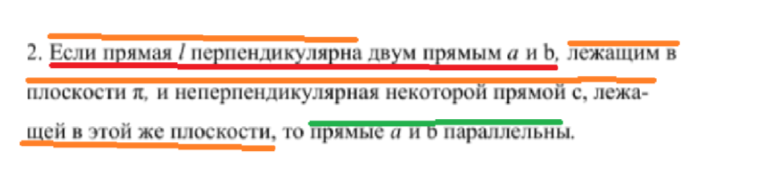
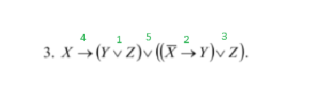
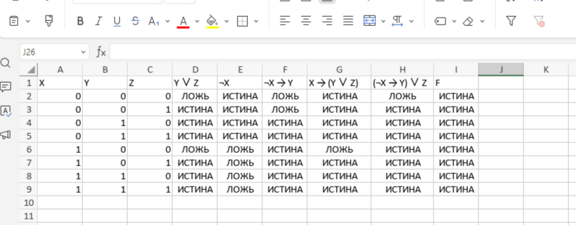
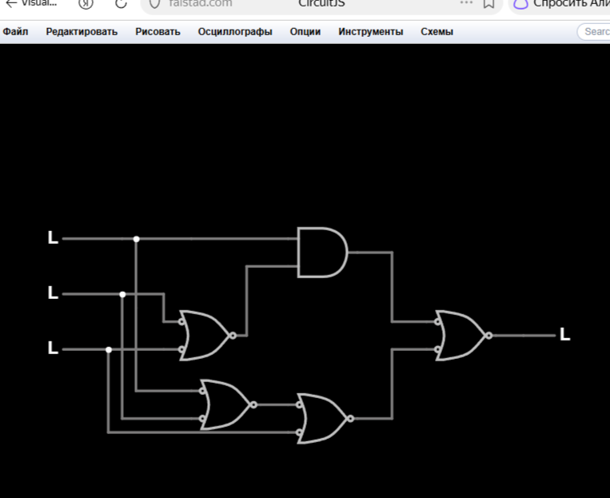

# Вариант 6: решение задач

## Задача 1
пример: $(X > 2) \vee (X < 2) \vee (X > 4)$, $X = 4$.
- $X > 2 \Rightarrow 4 > 2 \Rightarrow \text{истина}$;
- $X < 2 \Rightarrow 4 < 2 \Rightarrow \text{ложь}$;
- $X > 4 \Rightarrow 4 > 4 \Rightarrow \text{ложь}$;
- $\text{истина} + \text{ложь} + \text{ложь} = \text{истина}$.

Ответ: истина

---

## Задача 2

- A = Если прямая *l* перпендикулярна двум прямым *a* и *b*
- B = Если прямая *l* перпендикулярна лежащим в плоскости π, и неперпендикулярная некоторой прямой *c*, лежащей в этой же плоскости
- С = прямые *a* и *b* параллельны
---

## Задача 3

https://www.falstad.com/s.py?s=NhR0pm электронная схема
