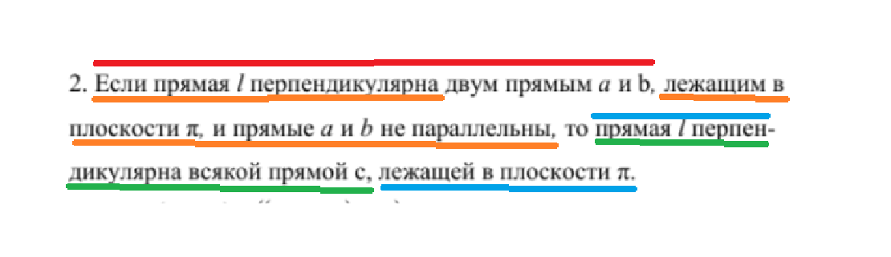

# Вариант 6: решение задач

## Задача 1
пример: $(X > 2) \vee (X < 2) \vee (X > 4)$, $X = 4$.
- $X > 2 \Rightarrow 4 > 2 \Rightarrow \text{истина}$;
- $X < 2 \Rightarrow 4 < 2 \Rightarrow \text{ложь}$;
- $X > 4 \Rightarrow 4 > 4 \Rightarrow \text{ложь}$;
- $\text{истина} + \text{ложь} + \text{ложь} = \text{истина}$.

Ответ: истина

---

## Задача 2

- A = Если прямая *l* перпендикулярна двум прямым *a* и *b*
- B = Если прямая *l* перпендикулярна  лежащим в плоскости π, и прямые *a* и *b* не параллельны
- С = прямая *l* перпендикулярна всякой прямой *c*
- D = прямая *l* перпендикулярна лежащей в плоскости π
---

## Задача 3
**Дано:** $(Y \vee Z \leftrightarrow X) \vee ((X \rightarrow Y) \vee Z)$.
**Решение:**
- $X \rightarrow Y = \overline{X} \vee Y$;
- $(\overline{X} \vee Y) \vee Z = \overline{X} \vee Y \vee Z$;
- $Y \vee Z \leftrightarrow X = ((Y \vee Z) \wedge X) \vee (\overline{Y} \wedge \overline{Z} \wedge \overline{X})$;
- Итоговое выражение: $((Y \vee Z) \wedge X) \vee (\overline{Y} \wedge \overline{Z} \wedge \overline{X}) \vee \overline{X} \vee Y \vee Z$;
- $\overline{X} \vee Y \vee Z$ делает выражение истинным при всех значениях переменных.
**Ответ:** $1$.